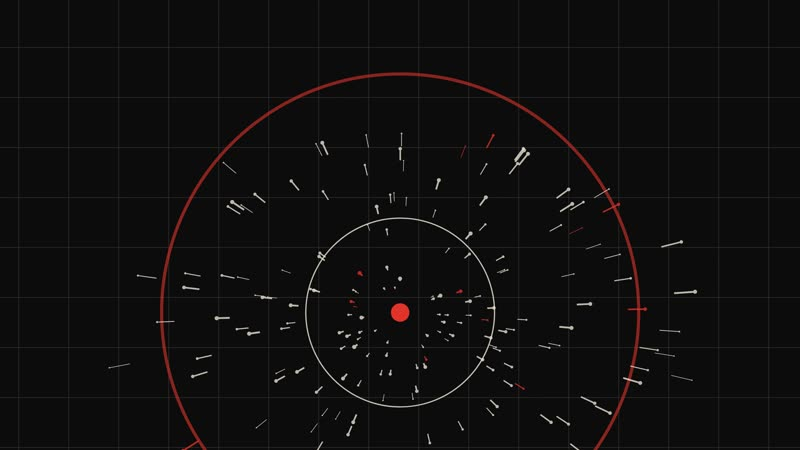
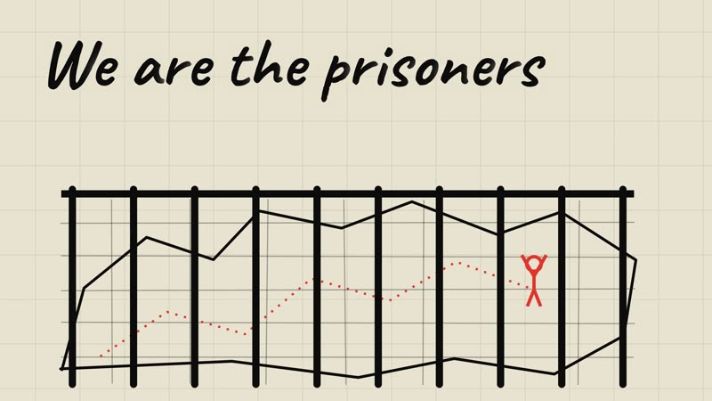
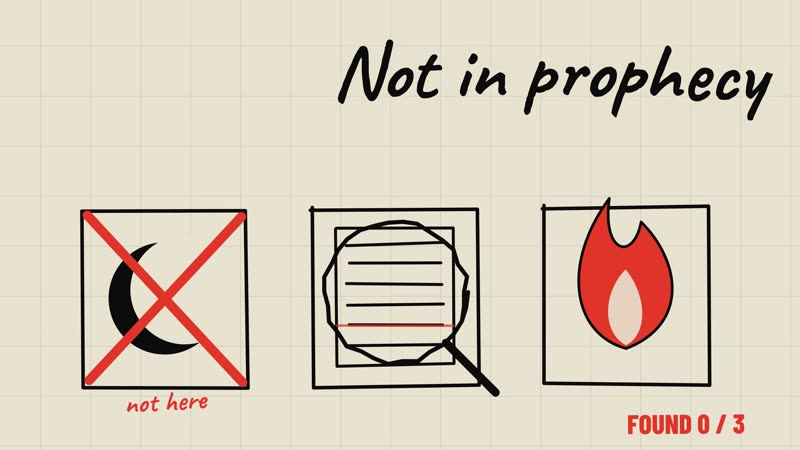
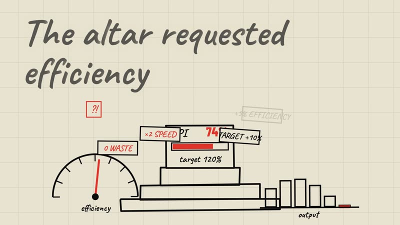
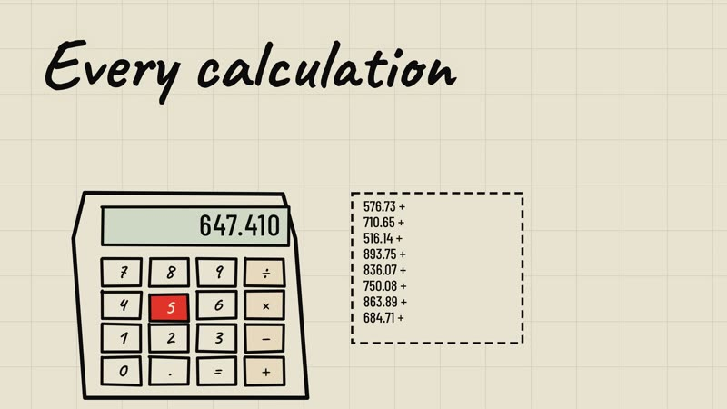
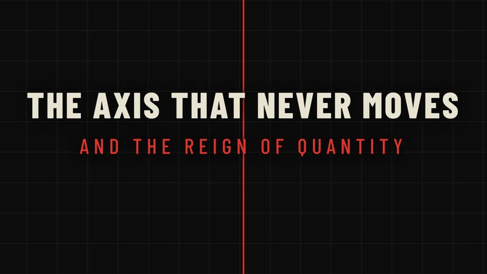

# lyric-motion-method

**Code-driven animated lyric videos. The hard part is not the animation — it is knowing, to the tenth of a second, when each word is actually sung.**

This repository documents how an 8½-minute, 4K lyric video was built entirely in code (React + Remotion), with an AI coding agent doing the engineering and a human doing the listening. It is a *method and a working engine*, not a prompt collection and not a "how to talk to an AI" tutorial. Everything here was measured on a real production, including what failed.

> Result: **[https://www.youtube.com/watch?v=k1q5sDrxTJ4](https://www.youtube.com/watch?v=k1q5sDrxTJ4)** — *The Axis That Never Moves and The Reign of Quantity* (4K, 30 fps, 8 min 34 s).
> Song and lyrics are **not** included in this repository (see [docs/09-legal.md](docs/09-legal.md)). A zero-rights demo is.

## What is actually in here

| You get | Where |
|---|---|
| A **lyric-alignment pipeline** that handles sung audio, choir repeats and ad-libs (Whisper anchors + windowed CTC forced alignment + a human override file) | [docs/02-alignment.md](docs/02-alignment.md), `tools/` |
| A **deterministic scene engine**: every frame is a pure function of song time → reproducible renders, cheap previews | [docs/03-scene-engine.md](docs/03-scene-engine.md), `src/` |
| An **art-direction rule set** that kept 60 different scenes visually coherent | [docs/04-art-direction.md](docs/04-art-direction.md) |
| A **log of every correction the human made**, classified by what a machine could and could not have caught | [docs/05-feedback-log.md](docs/05-feedback-log.md) |
| **Measured numbers** (render times, sizes, alignment accuracy) | [docs/06-numbers.md](docs/06-numbers.md) |
| A **failure log** (tooling traps, wrong turns) | [docs/07-pitfalls.md](docs/07-pitfalls.md) |
| Step-by-step **reproduction** with your own song | [docs/08-reproduce.md](docs/08-reproduce.md) |

## Try it in two minutes (no GPU, no Python, no song)

```bash
npm install
npm run studio          # interactive preview in the browser
npm run preview         # 640x360 MP4 in out/preview.mp4
```

The demo uses a synthetic test tone and four public-domain lines (William Blake, *The Tyger*, 1794) with hand-written timings. It exercises the intro, both visual "worlds", the camera, text modes and the title/credits sequence. Regenerate it with `python examples/make_demo.py`.

## Using it with Claude Code (or another coding agent)

This repo is written to be driven by an agent *and* a human who listens. You do not need to know React or forced alignment: you need your **audio**, your **exact lyrics**, and a pair of ears. Clone the repo, open it in your agent, and give it something like:

```text
I want to make an animated lyric video for my song using this repo.
1. Read README.md, AGENTS.md, docs/01-method.md, docs/02-alignment.md and docs/08-reproduce.md.
2. My audio is in audio/ and my exact lyrics are in data/lyrics.txt.
3. Set up the environment (Node + a Python venv; use my GPU if I have one, otherwise CPU with WHISPER_MODEL=small).
4. Run the alignment chain, show me the output of tools/match.py and the scene list,
   and ask me to confirm the timings by ear BEFORE drawing anything.
5. Then propose three 20-second style prototypes, build the one I pick scene by scene,
   and render a full half-resolution preview after each batch of changes.
Never tell me the sync is verified: I will listen and send notes as "m:ss — what is wrong".
```

Your side of the work: confirm by ear who sings what (lead vs. choir, repeats), choose a style, and watch each preview. See [docs/05-feedback-log.md](docs/05-feedback-log.md) for what that looked like in practice.

**Songs from Google Flow Music:** the lyrics block on a song page (`[Intro]`, `[Verse 1]` headers and `( … )` for the second voice) is already the format `data/lyrics.txt` expects. Paste it as is. Get the audio file from the app and put it in `audio/`.

**No NVIDIA GPU?** The alignment tools fall back to the CPU automatically (`DEVICE=cpu`; use a smaller Whisper model, e.g. `WHISPER_MODEL=small`). The CPU path was tested only on a 40-second excerpt.

## A few frames of the reference video

| | | |
|---|---|---|
|  <br>*Intro: the world begins (0–14 s, before the first word)* |  <br>*A line given its own object* |  <br>*One continuous scene over three sung phrases* |
|  <br>*A long scene kept alive with a target that is never reached* |  <br>*Objects redrawn after "too schematic"* |  <br>*Title card with the fixed red "axis"* |

## The thesis, in five points

1. **Alignment is the product.** A beautiful scene one second late reads as a bug. Spend your effort on timing, not on effects.
2. **An AI agent cannot hear.** It can read waveforms, transcripts and still frames. It cannot tell you that a choir repeat shifted everything after minute five. Design the loop around a human who listens and reports `mm:ss — what is wrong`. See [docs/05-feedback-log.md](docs/05-feedback-log.md).
3. **Make time the only input.** If `render(t)` is a pure function, a 90-frame 4K test, a half-resolution preview and the final render are the same code at different `--scale`.
4. **Coherence beats variety.** One rule ("every object on screen is an instrument of measurement or control") did more for the video than any effect.
5. **Prototype style before engineering.** Three 15–25 s prototypes in three different styles cost little and let the human choose with their eyes.

## Honest limits

- Tested on **one song, one language (English), one machine**, on Windows. The alignment pipeline is fast on a CUDA-capable NVIDIA GPU and falls back to the CPU (tested only on a short excerpt); every timing in this repo is indicative and will vary with your hardware.
- The reference scene table (`src/clip/Full.tsx`) is tied to that song's scene list. For your song you write your own table; the engine and objects are reusable.
- No automated visual or sync tests exist. Verification was: contact sheets of still frames (AI) + watching and listening (human).
- Synchronisation in the final video was judged by a human listener, not measured against ground truth.

## Repository layout

```
src/            Remotion project (engine, instruments, scene table, config)
tools/          Python alignment + analysis scripts (run in this order, see docs/08)
data/           demo data (words, scenes, audio analysis) — your runs overwrite these
public/         audio used by the render (demo tone included)
examples/       zero-rights demo generator
docs/           the method, in depth
AGENTS.md       conventions for AI coding agents working in this repo
```

## License

Code: MIT (see `LICENSE`). Fonts, models and Remotion have their own terms — see [docs/09-legal.md](docs/09-legal.md). The video, song and lyrics are not covered by this repository's license.
